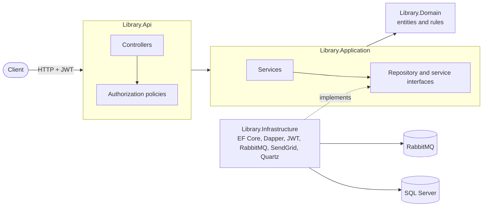
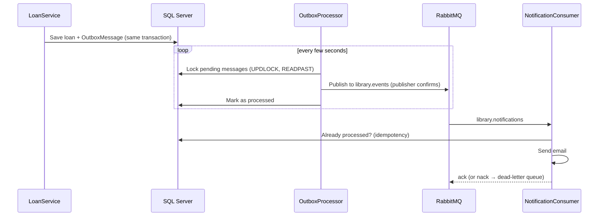

# Library Management API

[](https://github.com/reinansilveira/BibliotecaProjectBook/actions/workflows/ci.yml)


A REST API for a library: books, members and loans. Members are put on a **blacklist automatically** when they return a book late. Every important event (registration, loan, return, blacklisting) is published to **RabbitMQ** through a **transactional outbox**, and a consumer sends email notifications.

The Angular front end lives in a separate repository: **Library Web** (Angular 22, Angular Material, Playwright).


## Highlights

| Area | What is implemented |
|---|---|
| **Architecture** | Layered (Domain → Application → Infrastructure → API), feature folders, dependency rules enforced by **architecture tests** |
| **Security** | JWT access token (15 min) + **rotating refresh tokens** with reuse detection, Admin/Member roles, policies and **resource-based authorization**, **rate limiting** on sign-in, sign-up and refresh |
| **Messaging** | RabbitMQ, **transactional outbox**, competing-consumer-safe dispatch (`UPDLOCK, READPAST`), idempotent consumer, **dead-letter queue** |
| **SQL** | EF Core migrations, **Dapper** query with CTE + `DENSE_RANK`, **stored procedure**, filtered and covering indexes, pagination with `OFFSET/FETCH` |
| **Observability** | Serilog structured logs (JSON outside development), request logging with user id, `/health` checking SQL Server and RabbitMQ |
| **Errors** | RFC 9457 `ProblemDetails` from a single global exception handler (400/401/403/404/409/422) |
| **Quality** | 126 automated tests (unit, architecture, integration with real SQL Server and RabbitMQ) with **88% line coverage**, k6 load test, Roslynator + `.editorconfig` rules that fail the build, Dependabot |
| **Delivery** | Docker, Docker Compose, GitHub Actions CI (format check, build, tests with coverage, Docker image) and **CD** to free hosting (MonsterASP.NET with SQL Server for the API, GitHub Pages for the front end) with a smoke test on `/health` |

## Business rules

- A loan lasts **7 days**.
- A member can have **one active loan** at a time, and a book on loan cannot be borrowed by anyone else.
- An hourly **Quartz** job adds members with overdue loans to the **blacklist** (never twice). Blacklisted members cannot borrow; an admin can remove them only after the book is returned.
- Members can only see and change **their own data**. Admins manage the catalog, register returns, manage the blacklist and see reports.
- Books and members are **soft deleted**. A book on loan cannot be deleted.
- Passwords are stored with **PBKDF2 + random salt** and are never returned by the API.

## Architecture



```
src/
├── Library.Domain          Entities and business rules, no external dependencies
├── Library.Application     Use cases grouped by feature (Books, Members, Loans, Auth, Blacklist, Reports, Notifications)
├── Library.Infrastructure  Persistence, reports, security, messaging, email, scheduled job
└── Library.Api             Controllers, authentication and policies, error handling, logging, Swagger
tests/
├── Library.UnitTests          Domain, services, validators, security, messaging (xUnit, NSubstitute, Bogus, FakeTimeProvider)
├── Library.ArchitectureTests  Layer and naming rules (NetArchTest)
├── Library.IntegrationTests   Real HTTP calls against SQL Server and RabbitMQ containers (Testcontainers)
└── load                       k6 load test
```

More detail, including the messaging and authentication flows, is in [docs/architecture.md](docs/architecture.md). The main design decisions are recorded as ADRs in [docs/adr](docs/adr).

## Messaging



| Event | Routing key | Notification |
|---|---|---|
| `MemberRegisteredEvent` | `member.registered` | Welcome email |
| `LoanCreatedEvent` | `loan.created` | Loan confirmation with the due date |
| `LoanReturnedEvent` | `loan.returned` | Return receipt |
| `MemberBlacklistedEvent` | `member.blacklisted` | Overdue warning |

The RabbitMQ management UI is available at http://localhost:15672 (user `library`, password `library-dev`) when running with Docker Compose.

## Getting started

### With Docker (recommended)

Requirements: Docker.

```bash
cp .env.example .env    # optional: change passwords and keys
docker compose up --build
```

| Service | URL |
|---|---|
| Swagger | http://localhost:5080/swagger |
| Health check | http://localhost:5080/health |
| RabbitMQ management | http://localhost:15672 |

Migrations run and the first administrator is created on startup. Default local login: `admin@library.local` / `Admin@123`.

### With the .NET SDK

Requirements: [.NET 10 SDK](https://dotnet.microsoft.com/download) and Docker for SQL Server and RabbitMQ.

```bash
docker compose up -d sqlserver rabbitmq
dotnet tool restore
dotnet run --project src/Library.Api
```

## Deployment

The whole system runs on free hosting that needs no credit card:

| Part | Host |
|---|---|
| API | MonsterASP.NET (IIS, .NET 10) |
| Database | MonsterASP.NET SQL Server (free, 1 GB) |
| Front end | GitHub Pages |

After CI passes on `main`, the **Deploy** workflow publishes the API with Web Deploy and checks `/health` until it answers. The step-by-step guide is in [docs/deploy.md](docs/deploy.md).

## Authentication

1. `POST /api/auth/register` creates a member account.
2. `POST /api/auth/login` returns an **access token** (JWT, 15 minutes) and a **refresh token** (7 days, stored only as a SHA-256 hash).
3. Send the access token as `Authorization: Bearer <token>`.
4. `POST /api/auth/refresh` exchanges the refresh token for a new pair. Each refresh token works **once**; reusing an old one revokes **every session** of that member.
5. `POST /api/auth/logout` revokes the refresh token.

**Rate limiting.** Sign-in, sign-up, refresh and logout share a fixed-window limit per client IP (10 requests per minute by default, configurable). Extra requests get `429 Too Many Requests` as `ProblemDetails` with a `Retry-After` header, which slows down password guessing. Other endpoints, including `/api/auth/me`, are not limited. Behind a reverse proxy, set `RateLimiting:TrustForwardedHeaders` so the real client IP is read from `X-Forwarded-For`.

| Policy | Rule |
|---|---|
| Fallback | Every endpoint requires authentication unless marked `[AllowAnonymous]` |
| `AdminOnly` | Admin role |
| `MemberOrAdmin` | Any signed-in member |
| `ResourceOwnerOrAdmin` | The member who owns the data, or an admin (resource-based `AuthorizationHandler`) |

## Endpoints

| Method | Route | Access | Description |
|---|---|---|---|
| POST | `/api/auth/register` | Public | Create an account |
| POST | `/api/auth/login` | Public | Get access and refresh tokens |
| POST | `/api/auth/refresh` | Refresh token | Rotate the token pair |
| POST | `/api/auth/logout` | Refresh token | Revoke the refresh token |
| GET | `/api/auth/me` | Signed in | Current member |
| GET | `/api/books?search=&page=&pageSize=` | Public | Paginated catalog with search |
| GET | `/api/books/{id}` | Public | Book details |
| POST / PUT / DELETE | `/api/books[/{id}]` | Admin | Manage the catalog |
| GET | `/api/members?search=&page=&pageSize=` | Admin | Paginated members |
| GET / PUT | `/api/members/{id}` | Owner or admin | Member profile |
| DELETE | `/api/members/{id}` | Admin | Soft delete a member |
| GET | `/api/members/{id}/loans` | Owner or admin | Paginated loan history |
| GET | `/api/loans/{id}` | Owner or admin | Loan with status (Active, Overdue, Returned) |
| POST | `/api/loans` | Owner or admin | Borrow a book |
| POST | `/api/loans/{id}/return` | Admin | Register a return |
| GET | `/api/blacklist` | Admin | Paginated blacklist |
| POST | `/api/blacklist/refresh` | Admin | Run the overdue check now |
| DELETE | `/api/blacklist/{memberId}` | Admin | Remove a member from the blacklist |
| GET | `/api/reports/most-borrowed-books?from=&to=&top=` | Admin | Ranking (Dapper) |
| GET | `/api/reports/overdue-by-month?year=` | Admin | Monthly overdue report (stored procedure) |
| GET | `/health` | Public | SQL Server and RabbitMQ health |

Example error:

```json
{
  "type": "https://tools.ietf.org/html/rfc4918#section-11.2",
  "title": "Business rule violation",
  "status": 422,
  "detail": "The book is already on loan."
}
```

## Testing

```bash
dotnet test                 # unit, architecture and integration tests (Docker must be running)
```

| Type | Count | What it covers |
|---|---|---|
| Unit | 81 | Domain rules, services, events, notifications, validators, pagination, JWT, password hashing, outbox |
| Architecture | 12 | Layer dependencies and conventions (controllers, sealed services, repository contracts) |
| Integration | 33 | Real HTTP requests against **SQL Server and RabbitMQ containers**: authentication (401/403), loan flow, blacklist with a shifted clock, pagination, the Dapper report, the stored procedure, end-to-end messaging, rate limiting (429), CORS and Swagger configuration |
| Load | k6 | Catalog browsing and member sessions with latency and error thresholds |

**Coverage: 87.8% of lines, 75.6% of branches and 92.7% of methods** (generated EF Core migrations excluded). CI publishes the full HTML report as an artifact and the summary on the workflow page.

Latest local load test (30 + 5 virtual users, 1 minute): **0% errors**, catalog p95 **29 ms**, sign-up/login/refresh p95 **205 ms**. See [docs/testing.md](docs/testing.md) for how to run it and what each suite checks.

## Code quality

The build fails on any warning, including style rules enforced by [Roslynator](https://github.com/dotnet/roslynator) and `.editorconfig`:

- no unnecessary `else` and early returns instead of nested `if` (RCS1211, RCS1208)
- no nested ternary operators (RCS1238), braces always required (IDE0011)
- no duplicate or unnecessary blank lines, and a blank line after every block (IDE2000, RCS0063, IDE2003)
- no unused `using` directives (IDE0005)
- whitespace verified in CI with `dotnet format whitespace --verify-no-changes`

[Dependabot](.github/dependabot.yml) opens weekly pull requests for NuGet packages, GitHub Actions and Docker base images.

## Configuration and secrets

No production secret is stored in the repository. [`appsettings.Example.json`](src/Library.Api/appsettings.Example.json) lists every setting.

| Setting | Development | Docker / production |
|---|---|---|
| `ConnectionStrings:Database` | `appsettings.Development.json` | `ConnectionStrings__Database` |
| `Jwt:Key` (32+ characters) | `appsettings.Development.json` (local key) | `Jwt__Key` |
| `Seed:Admin:Email` / `Password` | `appsettings.Development.json` | `Seed__Admin__Email` / `Seed__Admin__Password` |
| `RabbitMq:*` | `appsettings.Development.json` | `RabbitMq__HostName`, `RabbitMq__UserName`, `RabbitMq__Password` |
| `SendGrid:ApiKey` / `FromEmail` | User Secrets | `SendGrid__ApiKey` / `SendGrid__FromEmail` |
| `Messaging:Enabled` | `true` | `Messaging__Enabled` |
| `RateLimiting:AuthenticationPermitLimit` / `AuthenticationWindowSeconds` | `10` per `60` seconds | `RateLimiting__AuthenticationPermitLimit` (`AUTH_RATE_LIMIT` in `.env`) |
| `RateLimiting:TrustForwardedHeaders` | `false` | `true` only behind a trusted reverse proxy |
| `Cors:AllowedOrigins` | empty (same origin) | front end address when it is hosted elsewhere (`Cors__AllowedOrigins__0`) |
| `Swagger:Enabled` | always on in Development | `Swagger__Enabled=true` to publish the docs |

Without a SendGrid key the API still works and logs that the email was not sent. Without a valid `Jwt:Key` the API refuses to start (`ValidateOnStart`).

## Tech stack

.NET 10 · ASP.NET Core · EF Core 10 · Dapper · SQL Server 2022 · RabbitMQ 4 · Quartz.NET · FluentValidation · Serilog · SendGrid · Swagger · xUnit v3 · NSubstitute · Bogus · Testcontainers · NetArchTest · k6 · Roslynator · Docker · GitHub Actions
