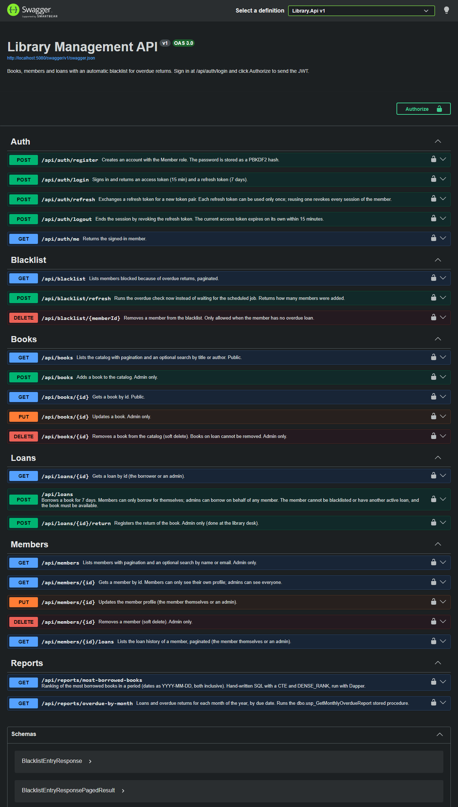
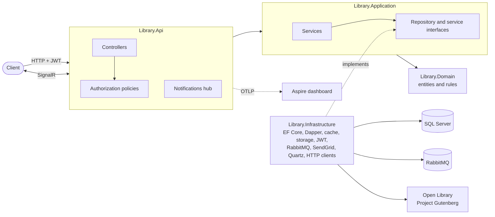

# Library Management API

[](https://github.com/reinansilveira/BibliotecaProjectBook/actions/workflows/ci.yml)


**Live demo:** [web app](https://reinansilveira.github.io/BibliotecaProjectBook-Web/) · [API (Swagger)](https://reinan-library-api.runasp.net/swagger) · [health](https://reinan-library-api.runasp.net/health)

A REST API for a real-world library: a catalog with **printed copies and e-books**, loans, **waiting lists**, **late fines**, **reviews**, **real-time notifications** and an admin area with dashboards, audit trail and CSV exports. Every important event is published to **RabbitMQ** through a **transactional outbox**, and traces, metrics and logs go to **OpenTelemetry**.

The Angular front end lives in a separate repository: **Library Web** (Angular 22, Angular Material, Playwright).



## Highlights

| Area | What is implemented |
|---|---|
| **Domain** | Printed copies with barcodes, e-books with concurrent **licenses**, loans (7 days print / 14 days e-book), **one renewal**, **waiting lists** with 48-hour holds, **fines per day late** that block new loans, reviews from readers only, wishlist |
| **Concurrency** | Per-book **application locks** (`sp_getapplock`) around borrow, return and queue changes, plus a filtered unique index so a copy can never be on two active loans; the integration tests race two members for the last copy |
| **Architecture** | Layered (Domain → Application → Infrastructure → API), feature folders, dependency rules enforced by **architecture tests**, **API versioning** (`/api/v1`) |
| **Security** | JWT access token (15 min) + **rotating refresh tokens** with reuse detection, roles and **resource-based authorization**, **rate limiting**, email confirmation and password reset with **single-use hashed tokens**, e-book downloads through **HMAC-signed links** that expire in 10 minutes |
| **SQL** | EF Core migrations, **full-text search** with prefix matching (falls back to `LIKE` where the feature is missing), Dapper queries with CTE, `DENSE_RANK` and multi-result sets, a **stored procedure**, filtered and covering indexes, pagination with `OFFSET/FETCH` |
| **Messaging** | RabbitMQ, transactional outbox, competing-consumer-safe dispatch (`UPDLOCK, READPAST`), idempotent consumer, dead-letter queue, 9 integration events |
| **Real time** | **SignalR** hub that pushes notifications after the transaction commits, plus a persistent inbox with unread count |
| **Performance** | **HybridCache** for the catalog, invalidated by tag whenever books, copies, loans, reservations or reviews change |
| **Integrations** | Book data and covers from **Open Library** by ISBN, public-domain EPUBs from **Project Gutenberg** (with a mirror fallback), resilient HTTP clients with retries, timeouts and circuit breaker |
| **Observability** | **OpenTelemetry** traces and metrics (ASP.NET Core, HttpClient, SQL, RabbitMQ) and Serilog logs in the **.NET Aspire dashboard**, `/health`, automatic **audit trail** of every change through an EF Core interceptor |
| **Errors** | RFC 9457 `ProblemDetails` from a single global exception handler (400/401/403/404/409/422/429) |
| **Quality** | 288 automated tests (unit, architecture, integration with real SQL Server and RabbitMQ) with **89% line coverage**, k6 load test, Roslynator + `.editorconfig` rules that fail the build, Dependabot |
| **Delivery** | Docker Compose (API, SQL Server with full-text, RabbitMQ, Aspire dashboard), GitHub Actions CI and **CD** to free hosting (MonsterASP.NET for the API and database, GitHub Pages for the front end) with a smoke test on `/health` |

## Business rules

- A printed loan lasts **7 days** and takes a specific copy; an e-book loan lasts **14 days**, uses one license and **expires on its own**.
- A member can have **3 active loans**, never two of the same book, and cannot borrow with an **overdue loan** or an **unpaid fine**.
- When nothing is free, the member joins the **waiting list**. When a copy or license comes back, the first member in line is notified (in real time and by email) and the book is **held for 48 hours**; an unclaimed hold goes to the next member.
- A loan can be **renewed once**, only when it is not overdue and **nobody is waiting** for the book.
- A late printed return issues a **fine of 0.50 per day** (configurable). Payment is simulated and returns a reference; admins can waive fines.
- Only members who **borrowed a book** can review it (1 to 5 stars). The average rating is recalculated in the same transaction.
- A scheduled job runs every 15 minutes: ends expired e-book loans, releases unclaimed holds, sends **due-tomorrow reminders** and **overdue notices**.
- Members only see and change **their own data**. Books and members are soft deleted; passwords use **PBKDF2 + random salt**.

## Architecture



```
src/
├── Library.Domain          Entities and business rules, no external dependencies
├── Library.Application     Use cases by feature: Books (catalog, inventory, import), Loans (and e-book reading),
│                           Reservations, Fines, Reviews, Wishlist, Inbox, Account, Auth, Audit, Reports, Maintenance
├── Library.Infrastructure  Persistence, search, cache, file storage, security, messaging, email, jobs, external APIs
└── Library.Api             Versioned controllers, SignalR hub, authentication and policies, errors, logging, telemetry
tests/
├── Library.UnitTests          Domain, services, validators, security, messaging, cache, HTTP clients
├── Library.ArchitectureTests  Layer and naming rules (NetArchTest)
├── Library.IntegrationTests   Real HTTP and SignalR calls against SQL Server (with full-text) and RabbitMQ containers
└── load                       k6 load test
```

More detail is in [docs/architecture.md](docs/architecture.md), and the main design decisions are recorded as ADRs in [docs/adr](docs/adr).

## Getting started

### With Docker (recommended)

Requirements: Docker.

```bash
cp .env.example .env    # optional: change passwords and keys
docker compose up --build
```

| Service | URL |
|---|---|
| Swagger | http://localhost:5080/swagger |
| Health check | http://localhost:5080/health |
| Aspire dashboard (traces, metrics, logs) | http://localhost:18888 |
| RabbitMQ management | http://localhost:15672 (`library` / `library-dev`) |

On the first start the API applies the migrations, creates the administrator (`admin@library.local` / `Admin@123`) and a **demo catalog of 18 classics** with real covers, then downloads their public-domain EPUBs from Project Gutenberg in the background.

### With the .NET SDK

Requirements: [.NET 10 SDK](https://dotnet.microsoft.com/download) and Docker for SQL Server and RabbitMQ.

```bash
docker compose up -d sqlserver rabbitmq aspire-dashboard
dotnet tool restore
dotnet run --project src/Library.Api
```

## Deployment

The whole system runs on free hosting that needs no credit card:

| Part | Host |
|---|---|
| API | MonsterASP.NET (IIS, .NET 10) |
| Database | MonsterASP.NET SQL Server (free, 1 GB) |
| Front end | GitHub Pages |

After CI passes on `main`, the **Deploy** workflow publishes the API with Web Deploy and checks `/health` until it answers. The step-by-step guide is in [docs/deploy.md](docs/deploy.md).

## Authentication

1. `POST /api/v1/auth/register` creates a member account and emails a confirmation link.
2. `POST /api/v1/auth/login` returns an **access token** (JWT, 15 minutes) and a **refresh token** (7 days, stored only as a SHA-256 hash).
3. Send the access token as `Authorization: Bearer <token>` (SignalR also accepts it as `access_token` in the query string).
4. `POST /api/v1/auth/refresh` exchanges the refresh token for a new pair. Each refresh token works **once**; reusing an old one revokes **every session**.
5. `POST /api/v1/auth/forgot-password` emails a reset link valid for one hour, and always answers `202` so it does not reveal which emails exist. Resetting or changing the password signs out every session.

Sign-in, sign-up, refresh, logout and the password endpoints share a rate limit per client IP (10 requests per minute by default). Extra requests get `429` with `Retry-After`.

| Policy | Rule |
|---|---|
| Fallback | Every endpoint requires authentication unless marked `[AllowAnonymous]` |
| `AdminOnly` | Admin role |
| `MemberOrAdmin` | Any signed-in member |
| `ResourceOwnerOrAdmin` | The member who owns the data, or an admin (resource-based `AuthorizationHandler`) |

## Endpoints

All routes start with `/api/v1`. The full contract, with examples, is in Swagger.

| Area | Main routes | Access |
|---|---|---|
| Auth | `auth/register`, `login`, `refresh`, `logout`, `me`, `confirm-email`, `resend-confirmation`, `forgot-password`, `reset-password`, `change-password` | Public / signed in |
| Catalog | `GET books?search=&genre=&author=&yearFrom=&yearTo=&format=&availableOnly=&sort=`, `books/suggestions?query=`, `books/genres`, `books/{id}`, `books/{id}/also-read` | Public |
| Catalog admin | `POST/PUT/DELETE books`, `books/lookup?isbn=`, `books/import`, `books/{id}/copies`, `books/{id}/ebook` (upload), `books/{id}/ebook/gutenberg`, `books/{id}/ebook/licenses`, `books/{id}/reservations` | Admin |
| Reviews | `GET books/{id}/reviews`, `GET/PUT/DELETE books/{id}/reviews/mine` | Public / readers |
| Loans | `POST loans`, `GET loans/{id}`, `loans/{id}/renew`, `loans/{id}/return`, `loans/{id}/reading-link`, `PUT loans/{id}/progress` | Owner or admin |
| E-books | `GET ebooks/{loanId}/content?expires=&signature=` | Signed link |
| Reservations | `POST reservations`, `GET/DELETE reservations/{id}` | Owner or admin |
| Fines | `GET fines` (admin), `GET fines/{id}`, `fines/{id}/pay`, `fines/{id}/waive` (admin) | Owner or admin |
| Members | `members`, `members/{id}`, `/loans`, `/reservations`, `/fines`, `/standing`, `/reading-stats`, `/wishlist[/{bookId}]` | Owner or admin |
| Notifications | `notifications`, `notifications/unread-count`, `notifications/{id}/read`, `notifications/read-all`, hub at `/hubs/notifications` | Signed in |
| Admin | `reports/dashboard`, `reports/most-borrowed-books[/export]`, `reports/overdue-by-month[/export]`, `reports/loans/export`, `audit`, `maintenance/run` | Admin |
| Health | `/health` | Public |

Example error:

```json
{
  "type": "https://tools.ietf.org/html/rfc4918#section-11.2",
  "title": "Business rule violation",
  "status": 422,
  "detail": "No copies are available right now. Join the waiting list."
}
```

## Messaging and real time

| Event | Routing key | Email |
|---|---|---|
| `MemberRegisteredEvent` | `member.registered` | Welcome |
| `EmailConfirmationRequestedEvent` | `member.email-confirmation-requested` | Confirmation link |
| `PasswordResetRequestedEvent` | `member.password-reset-requested` | Reset link |
| `LoanCreatedEvent` | `loan.created` | Loan confirmation |
| `LoanReturnedEvent` | `loan.returned` | Return receipt |
| `LoanDueSoonEvent` | `loan.due-soon` | Due tomorrow |
| `LoanOverdueEvent` | `loan.overdue` | Overdue notice with the daily fine |
| `ReservationReadyEvent` | `reservation.ready` | Your reserved book is available |
| `FineIssuedEvent` | `fine.issued` | Late return fine |

In-app notifications are saved in the same transaction as the change and pushed through SignalR only **after the commit**, so a rolled-back operation never notifies anyone. See [docs/architecture.md](docs/architecture.md) for the sequence diagrams.

## Testing

```bash
dotnet test                 # unit, architecture and integration tests (Docker must be running)
```

| Type | Count | What it covers |
|---|---|---|
| Unit | 217 | Domain rules (loans, reservations, fines, reviews, tokens), every service, validators, ISBN check digits, CSV escaping, e-book file checks, signed links, cache, Open Library mapping, JWT, hashing, outbox |
| Architecture | 12 | Layer dependencies and conventions |
| Integration | 59 | Real HTTP and SignalR calls against **SQL Server (with full-text) and RabbitMQ containers**: waiting list with holds, fines and payment, renewals, the race for the last copy, e-book upload, signed download with ranges and expiry, reading progress, full-text search, filters, ISBN import, reviews, wishlist, also-read, real-time notifications, audit trail, email confirmation and password reset through RabbitMQ, dashboard and CSV, versioning, the Dapper report and the stored procedure |
| Load | k6 | Catalog browsing and member sessions with latency and error thresholds |

**Coverage: 88.6% of lines and 75.3% of branches** (generated EF Core migrations excluded). See [docs/testing.md](docs/testing.md).

## Code quality

The build fails on any warning, including style rules enforced by [Roslynator](https://github.com/dotnet/roslynator) and `.editorconfig`: no unnecessary `else` and early returns instead of nested `if`, no nested ternaries, braces always required, no unused `using` directives and consistent blank lines. CI also runs `dotnet format whitespace --verify-no-changes`. [Dependabot](.github/dependabot.yml) opens weekly pull requests for NuGet packages, GitHub Actions and Docker images.

## Configuration and secrets

No production secret is stored in the repository. [`appsettings.Example.json`](src/Library.Api/appsettings.Example.json) lists every setting; environment variables use `__` for nesting.

| Setting | Default | Notes |
|---|---|---|
| `ConnectionStrings:Database` | development database | Required |
| `Jwt:Key` | development key | 32+ characters; the API refuses to start without it. Also derives the key that signs e-book links |
| `Seed:Admin:Email` / `Password` | `admin@library.local` in development | First administrator |
| `Seed:DemoCatalog` / `Seed:DemoEbooks` | `true` in development | Demo books with covers, and their Gutenberg EPUBs |
| `Account:FrontEndUrl` | `http://localhost:4200` | Base of the confirmation and reset links |
| `Fines:DailyRate` / `Currency` | `0.50` / `USD` | Late return fine |
| `Caching:Enabled` / `CatalogSeconds` | `true` / `120` | HybridCache for the catalog |
| `Search:UseFullText` | `true` | Uses the full-text index when SQL Server has it |
| `MaintenanceJob:Cron` | every 15 minutes | Expirations, holds, reminders and notices |
| `Messaging:Enabled`, `RabbitMq:*` | `true` | Outbox processor and consumer |
| `SendGrid:ApiKey` / `FromEmail` | empty | Without a key the email is only logged |
| `OTEL_EXPORTER_OTLP_ENDPOINT` | empty | Turns on OpenTelemetry export (set by Docker Compose) |
| `RateLimiting:*`, `Cors:AllowedOrigins`, `Swagger:Enabled` | see example file | |

## Tech stack

.NET 10 · ASP.NET Core · EF Core 10 · Dapper · SQL Server 2022 (full-text) · RabbitMQ 4 · SignalR · HybridCache · Quartz.NET · FluentValidation · Serilog · OpenTelemetry · .NET Aspire dashboard · Asp.Versioning · Polly (Microsoft.Extensions.Http.Resilience) · SendGrid · Swagger · xUnit v3 · NSubstitute · Bogus · Testcontainers · NetArchTest · k6 · Roslynator · Docker · GitHub Actions
