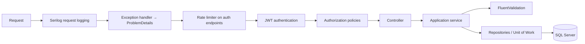
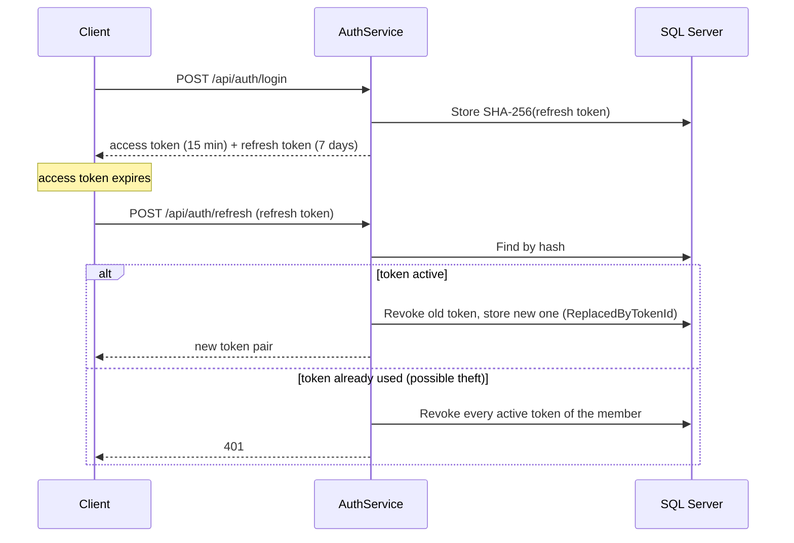
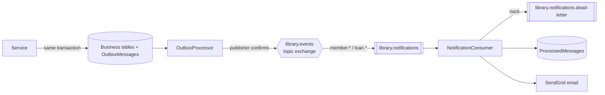

# Architecture

## Layers

| Project | Responsibility | May depend on |
|---|---|---|
| `Library.Domain` | Entities (`Book`, `Member`, `Loan`, `BlacklistEntry`, `RefreshToken`) and their invariants | nothing |
| `Library.Application` | Use cases, DTOs, validation, repository and service contracts, integration events | Domain |
| `Library.Infrastructure` | EF Core, Dapper, JWT, password hashing, RabbitMQ, SendGrid, Quartz | Application, Domain |
| `Library.Api` | HTTP, authentication, authorization policies, error handling, logging, OpenAPI | Application, Infrastructure (composition root only) |

These rules are verified by `tests/Library.ArchitectureTests`. For example, the build fails if the Application layer references EF Core or if a controller uses the `DbContext`.

The Application layer is organized by **feature** instead of by technical type:

```
Library.Application/
├── Abstractions      IUnitOfWork, IPasswordHasher, ITokenService, IEmailSender, IEventPublisher
├── Common            Exceptions and pagination
├── Events            Integration events published to the broker
├── Auth              Login, refresh token rotation, logout
├── Books / Members / Loans / Blacklist / Reports / Notifications
```

## Request pipeline



- Controllers have no business logic and no `try/catch`. Exceptions are translated by `GlobalExceptionHandler`: validation → 400, `UnauthorizedException` → 401, `NotFoundException` → 404, `ConflictException` → 409, `DomainException` → 422, anything else → 500 (logged).
- Sign-in, sign-up, refresh and logout go through a fixed-window rate limiter partitioned by client IP; rejected requests get `429` as `ProblemDetails` with `Retry-After`.
- `TimeProvider` is injected everywhere instead of `DateTime.Now`, so tests can move the clock to simulate overdue loans and expired tokens.

## Authentication flow



## Messaging with a transactional outbox

Publishing directly to RabbitMQ inside a request would be unreliable: the database transaction can commit while the publish fails, or the publish can succeed while the transaction rolls back. The outbox avoids both problems:

1. Services call `IEventPublisher.Publish(event)`. `OutboxEventPublisher` serializes the event into an `OutboxMessage` row tracked by the same `DbContext`, so it is saved in the **same transaction** as the business change.
2. `OutboxProcessor` (a `BackgroundService`) polls every few seconds. It locks a batch with `SELECT TOP (n) ... WITH (UPDLOCK, READPAST, ROWLOCK)` inside a transaction, so several API instances can run it without publishing the same message twice.
3. Messages are published to the `library.events` topic exchange with **publisher confirms** and persistent delivery. Failures increase `Attempts` and store `LastError`; a message stops being retried after `MaxPublishAttempts`.
4. `NotificationConsumer` listens to `library.notifications`. Before handling a message it checks the `ProcessedMessages` table (**idempotent consumer**), because delivery is at-least-once.
5. If handling fails, the message is rejected without requeue and goes to `library.notifications.dead-letter` for inspection.



## Data model and indexes

| Table | Notable indexes |
|---|---|
| `Books` | `Title` and `Author`, both **filtered** with `WHERE IsDeleted = 0` |
| `Members` | unique `Email`; `Name` filtered by `IsDeleted = 0` |
| `Loans` | `(MemberId, ReturnedAt)` and `(BookId, ReturnedAt)` for the loan rules; `DueDate INCLUDE (ReturnedAt)` and `LoanDate INCLUDE (BookId)` as **covering indexes** for the reports |
| `BlacklistEntries` | unique `MemberId` |
| `RefreshTokens` | unique `TokenHash`; `(MemberId, RevokedAt)` |
| `OutboxMessages` | `OccurredAt` filtered by `ProcessedAt IS NULL` (only pending messages) |
| `ProcessedMessages` | primary key on `MessageId` |

## Reports

- **Most borrowed books**: hand-written SQL executed with Dapper, using a CTE and `DENSE_RANK()`, with typed `DATETIME2` parameters and a half-open date interval (`>= start AND < end`) so the index on `LoanDate` can be used.
- **Monthly overdue report**: the `dbo.usp_GetMonthlyOverdueReport` stored procedure, created by the initial migration. It always returns the 12 months (a `VALUES` table joined with the loans), with totals, overdue percentage and average days overdue. The current time is passed as a parameter so results are deterministic in tests.
