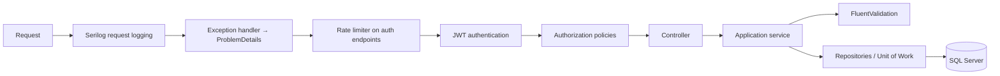
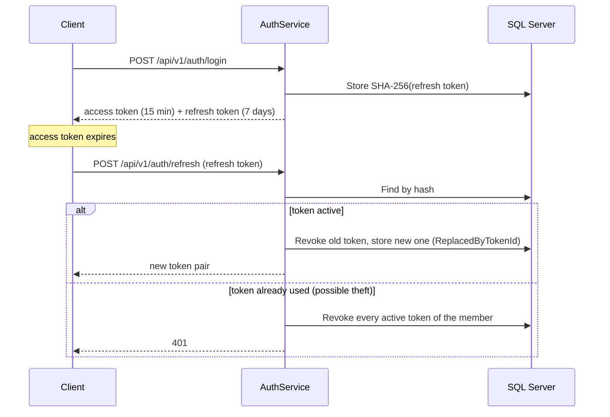
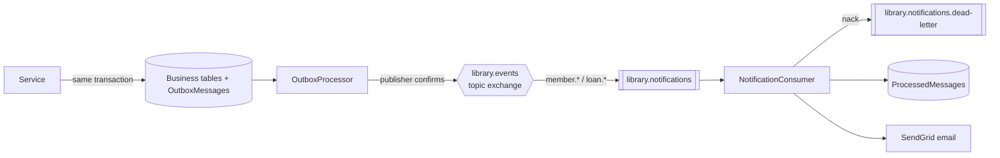
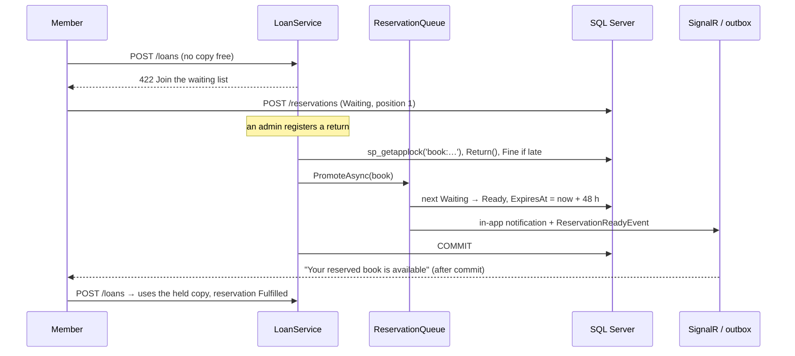

# Architecture

## Layers

| Project | Responsibility | May depend on |
|---|---|---|
| `Library.Domain` | Entities (`Book`, `BookCopy`, `Member`, `Loan`, `Reservation`, `Fine`, `Review`, `WishlistItem`, `Notification`, `AuditEntry`, `OneTimeToken`, `RefreshToken`) and their invariants | nothing |
| `Library.Application` | Use cases, DTOs, validation, repository and service contracts, integration events | Domain |
| `Library.Infrastructure` | EF Core, Dapper, full-text search, HybridCache, file storage, JWT, signed links, password hashing, RabbitMQ, SendGrid, Quartz, Open Library and Gutenberg clients, interceptors | Application, Domain |
| `Library.Api` | HTTP (versioned), SignalR hub, authentication, authorization policies, error handling, logging, OpenTelemetry, OpenAPI | Application, Infrastructure (composition root only) |

These rules are verified by `tests/Library.ArchitectureTests`. For example, the build fails if the Application layer references EF Core or if a controller uses the `DbContext`.

The Application layer is organized by **feature** instead of by technical type:

```
Library.Application/
├── Abstractions      IUnitOfWork (transactions and locks), ICatalogCache, IFileStorage, ICurrentUser, IRealtimeNotifier, ...
├── Common            Exceptions, pagination, CSV writer, validation rules
├── Events            Integration events published to the broker
├── Auth / Account    Login and token rotation; email confirmation, password reset and change
├── Books             Catalog and search; Inventory (copies, e-books); Import (ISBN)
├── Loans             Borrow, return, renew; Reading (signed e-book links, progress)
├── Reservations      Waiting list and the queue that promotes the next member
├── Fines             Fines and member standing
├── Reviews / Wishlist / Inbox / Audit / Reports / Maintenance / Notifications
```

## Request pipeline



- Controllers have no business logic and no `try/catch`. Exceptions are translated by `GlobalExceptionHandler`: validation → 400, `UnauthorizedException` → 401, `NotFoundException` → 404, `ConflictException` → 409, `DomainException` → 422, anything else → 500 (logged).
- Sign-in, sign-up, refresh and logout go through a fixed-window rate limiter partitioned by client IP; rejected requests get `429` as `ProblemDetails` with `Retry-After`.
- `TimeProvider` is injected everywhere instead of `DateTime.Now`, so tests can move the clock to simulate overdue loans and expired tokens.

## Authentication flow



## Messaging with a transactional outbox

Publishing directly to RabbitMQ inside a request would be unreliable: the database transaction can commit while the publish fails, or the publish can succeed while the transaction rolls back. The outbox avoids both problems:

1. Services call `IEventPublisher.Publish(event)`. `OutboxEventPublisher` serializes the event into an `OutboxMessage` row tracked by the same `DbContext`, so it is saved in the **same transaction** as the business change.
2. `OutboxProcessor` (a `BackgroundService`) polls every few seconds. It locks a batch with `SELECT TOP (n) ... WITH (UPDLOCK, READPAST, ROWLOCK)` inside a transaction, so several API instances can run it without publishing the same message twice.
3. Messages are published to the `library.events` topic exchange with **publisher confirms** and persistent delivery. Failures increase `Attempts` and store `LastError`; a message stops being retried after `MaxPublishAttempts`.
4. `NotificationConsumer` listens to `library.notifications`. Before handling a message it checks the `ProcessedMessages` table (**idempotent consumer**), because delivery is at-least-once.
5. If handling fails, the message is rejected without requeue and goes to `library.notifications.dead-letter` for inspection.



## Data model and indexes

| Table | Notable indexes |
|---|---|
| `Books` | `Title` and `Author`, both **filtered** with `WHERE IsDeleted = 0` |
| `Members` | unique `Email`; `Name` filtered by `IsDeleted = 0` |
| `Loans` | `(MemberId, ReturnedAt)` and `(BookId, ReturnedAt)` for the loan rules; `DueDate INCLUDE (ReturnedAt)` and `LoanDate INCLUDE (BookId)` as **covering indexes** for the reports |
| `BookCopies` | unique `Barcode`; `(BookId, WithdrawnAt)` |
| `Loans` (new) | **filtered unique** `CopyId WHERE ReturnedAt IS NULL` (a copy is never on two active loans); `(BookId, Format, ReturnedAt)` |
| `Reservations` | **filtered unique** `(BookId, MemberId, Format) WHERE Status IN (Waiting, Ready)`; `(BookId, Format, Status, CreatedAt)` for the queue; `ExpiresAt` filtered by `Status = Ready` |
| `Fines` | unique `LoanId`; `(MemberId, Status) INCLUDE (Amount)` |
| `Reviews` | unique `(BookId, MemberId)` |
| `Notifications` | `(MemberId, CreatedAt)`; `MemberId` filtered by `ReadAt IS NULL` for the unread badge |
| `AuditEntries` | `OccurredAt`, `(EntityType, EntityId)`, `ActorId` |
| `OneTimeTokens` | unique `TokenHash` |
| `Books` (new) | unique `Isbn` filtered by `IS NOT NULL AND IsDeleted = 0`; `Genre`; **full-text index** on `Title, Author, Description` |
| `RefreshTokens` | unique `TokenHash`; `(MemberId, RevokedAt)` |
| `OutboxMessages` | `OccurredAt` filtered by `ProcessedAt IS NULL` (only pending messages) |
| `ProcessedMessages` | primary key on `MessageId` |

## Reports

- **Most borrowed books**: hand-written SQL executed with Dapper, using a CTE and `DENSE_RANK()`, with typed `DATETIME2` parameters and a half-open date interval (`>= start AND < end`) so the index on `LoanDate` can be used.
- **Monthly overdue report**: the `dbo.usp_GetMonthlyOverdueReport` stored procedure, created by the initial migration. It always returns the 12 months (a `VALUES` table joined with the loans), with totals, overdue percentage and average days overdue. The current time is passed as a parameter so results are deterministic in tests.

## Circulation: copies, licenses and the waiting list

Availability is never stored; it is computed in SQL from the source of truth:

| Format | Free capacity |
|---|---|
| Print | copies in circulation − active printed loans − ready holds |
| E-book | licenses − active (not expired) e-book loans − ready holds |

Every operation that changes capacity (borrow, return, renew, add or withdraw copies, change licenses, cancel or expire a hold) runs in a transaction that first takes an **application lock for that book** with `sp_getapplock`. Requests for different books never wait for each other; two requests for the same book are serialized, so the capacity check and the insert cannot interleave. A **filtered unique index** on `Loans(CopyId) WHERE ReturnedAt IS NULL` is the last line of defence, and a unique violation becomes `409 Conflict` instead of a 500.



The `MaintenanceService` (Quartz, every 15 minutes, or `POST /maintenance/run`) ends expired e-book loans, expires holds that were not picked up and promotes the next member, and sends due-tomorrow reminders and overdue notices once (`ReminderSentAt`, `OverdueNoticeSentAt`).

## E-books

- Files (EPUB or PDF, checked by extension **and** magic bytes, up to 25 MB) are stored behind `IFileStorage`. The implementation keeps them in a `StoredFiles` table, which survives redeploys on shared hosting and can be swapped for blob storage without touching the use cases.
- Readers never get a permanent URL. `POST /loans/{id}/reading-link` returns `/ebooks/{loanId}/content?expires=…&signature=…`, valid for 10 minutes. The signature is an **HMAC-SHA256** of the loan id and the expiry with a key derived from the JWT key, compared in constant time. The content endpoint also checks that the loan is still active, so returning the e-book invalidates every link.
- Downloads support HTTP range requests, so readers such as epub.js can fetch parts of the file. Reading position (an EPUB CFI) and percentage are saved per loan.

## Real-time notifications

`IInbox.Add` only stages a `Notification` entity in the current unit of work, so it is saved atomically with the change that caused it. `NotificationDispatchInterceptor` (an EF Core `ISaveChangesInterceptor` and `IDbTransactionInterceptor`) collects the added notifications and pushes them through the SignalR hub **only after the transaction commits**; on rollback they are discarded. Users are identified by the `sub` claim, and the hub reads the JWT from the `access_token` query string because browsers cannot set headers on WebSocket requests.

## Audit trail

`AuditInterceptor` runs on every `SaveChanges`. For audited entities it writes an `AuditEntry` in the same transaction with the actor (from the JWT, or `system` for jobs), a meaningful action (`Book.Created`, `Loan.Returned`, `Fine.Paid`, `Reservation.Ready`, `BookCopy.Withdrawn`, …) and a JSON document with the changed values. Password hashes are masked and noisy fields such as reading progress are ignored.

## Search and caching

- With the full-text feature installed (the Docker image adds `mssql-server-fts`), a migration creates a full-text index on `Title`, `Author` and `Description`, and the search uses `CONTAINS` with prefix terms built from the words typed (`"jane*" AND "eyre*"`), so user input can never inject full-text operators. New books become searchable once SQL Server populates the index, usually within a second or two. Where full-text is not available, as on most shared hosts, the repository detects it and falls back to `LIKE`.
- The catalog (search pages, book details, genres, suggestions, "also read") goes through `ICatalogCache`, implemented with **HybridCache** and a `catalog` tag. Every write that changes availability, ratings or book data invalidates the tag, so the cache never serves stale availability.

## Observability

When `OTEL_EXPORTER_OTLP_ENDPOINT` is set, the API exports **traces** (ASP.NET Core, HttpClient, SQL Client and RabbitMQ), **metrics** (ASP.NET Core, HttpClient, .NET runtime) and the **Serilog logs** through OTLP. Docker Compose runs the .NET Aspire dashboard, so a single request can be followed from the controller to the SQL statements and the published message at http://localhost:18888.

## API versioning

Routes are versioned in the URL (`/api/v1/...`) with `Asp.Versioning`, and responses carry the `api-supported-versions` header. A future breaking change can ship as `v2` while `v1` keeps working for the published front end.
