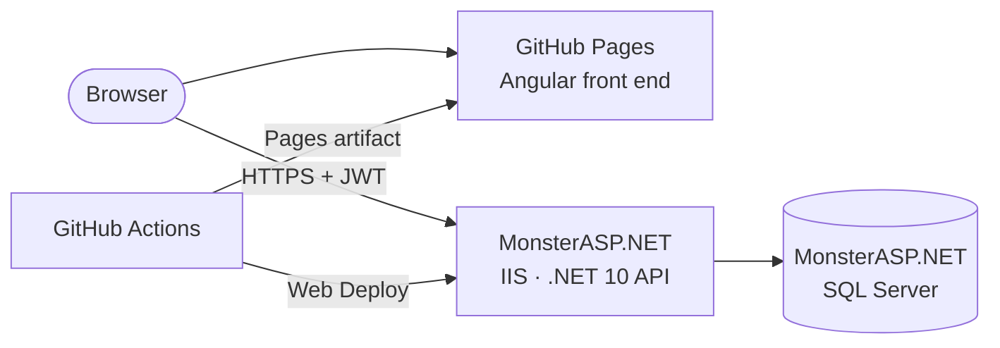

# Deploying for free

The whole system runs on free hosting that needs no credit card, and GitHub Actions deploys it after every successful CI run on `main`.



| Part | Host | Limits of the free plan |
|---|---|---|
| API | MonsterASP.NET | 256 MB of memory, 5 GB of disk, free `*.runasp.net` address. The first request after an idle period is slower. |
| Database | MonsterASP.NET SQL Server | 1 GB. |
| Front end | GitHub Pages | Public repository. |

RabbitMQ is not part of the free setup, so `Messaging__Enabled` is `false` in the cloud: events are still written to the outbox table, and no email is sent. To enable it, point `RabbitMq__*` to a hosted broker such as CloudAMQP and set `Messaging__Enabled` to `true`.

## 1. Create the website and the database

1. Create a free account at https://www.monsterasp.net (no credit card).
2. In the control panel, create a **website**. Write down its address (`https://<name>.runasp.net`) and its id (`siteXXXXX`).
3. Create a **MSSQL database**. Open it, go to **Users** and copy the **Local access** connection string.
4. Ask MonsterASP support to **activate HTTPS** for the website. The free plan enables it on request, and the front end (served over HTTPS) can only call an HTTPS API.

## 2. Configure the API

In the website, open **Scripting → Environment variables**, add the values below and choose **Restart application**:

| Name | Value |
|---|---|
| `ASPNETCORE_ENVIRONMENT` | `Production` (JSON logs) |
| `ConnectionStrings__Database` | the connection string from step 1 |
| `Jwt__Key` | a random value of at least 32 characters |
| `Seed__Admin__Email` | the first administrator's email |
| `Seed__Admin__Password` | the first administrator's password |
| `Database__ApplyMigrationsOnStartup` | `true` |
| `Swagger__Enabled` | `true`, so the API can be explored from the portfolio link |
| `Messaging__Enabled` | `false` |
| `Cors__AllowedOrigins__0` | `https://<your-user>.github.io` |

A random key can be generated with PowerShell:

```powershell
[Convert]::ToBase64String([Security.Cryptography.RandomNumberGenerator]::GetBytes(48))
```

The secrets live only on the host. GitHub never sees them.

## 3. Configure the API repository

1. In the website, open **Deploy**, find the **Visual Studio access** card and turn **WebDeploy** on. It shows the site, login and password.
2. In this repository, open **Settings → Secrets and variables → Actions** and add:

| Kind | Name | Value |
|---|---|---|
| Secret | `WEBSITE_NAME` | `siteXXXXX` |
| Secret | `SERVER_COMPUTER_NAME` | `https://siteXXXXX.siteasp.net:8172` |
| Secret | `SERVER_USERNAME` | `siteXXXXX` |
| Secret | `SERVER_PASSWORD` | the Web Deploy password |
| Variable | `API_URL` | `https://<name>.runasp.net` |

## 4. Configure the front end repository

1. Open **Settings → Pages** and set **Source** to **GitHub Actions**.
2. Open **Settings → Secrets and variables → Actions** and add the variable `API_BASE_URL` with the API address (`https://<name>.runasp.net`).

## 5. Deploy

Push to `main` (or run the **Deploy** workflow manually from the **Actions** tab). After CI passes:

- the API workflow publishes the app for IIS, sends it with Web Deploy and calls `/health` until it answers;
- the front end workflow builds Angular with the API address and the repository name as base path, and publishes it to `https://<your-user>.github.io/<repository>/`.

The API applies the migrations and creates the administrator on the first start. Swagger is available at `https://<name>.runasp.net/swagger`.
